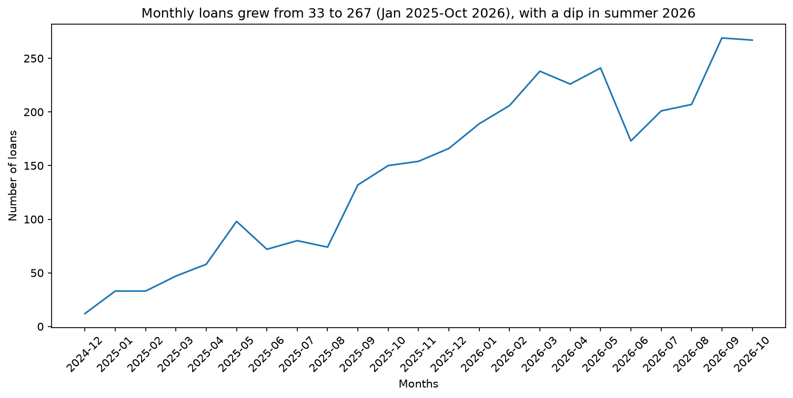
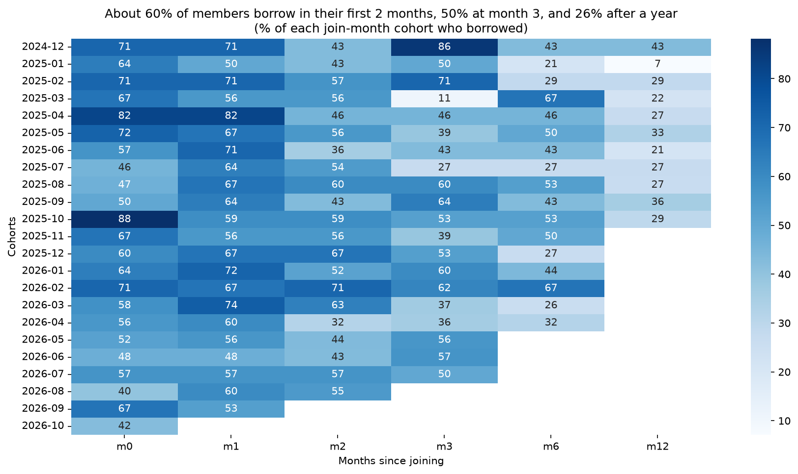
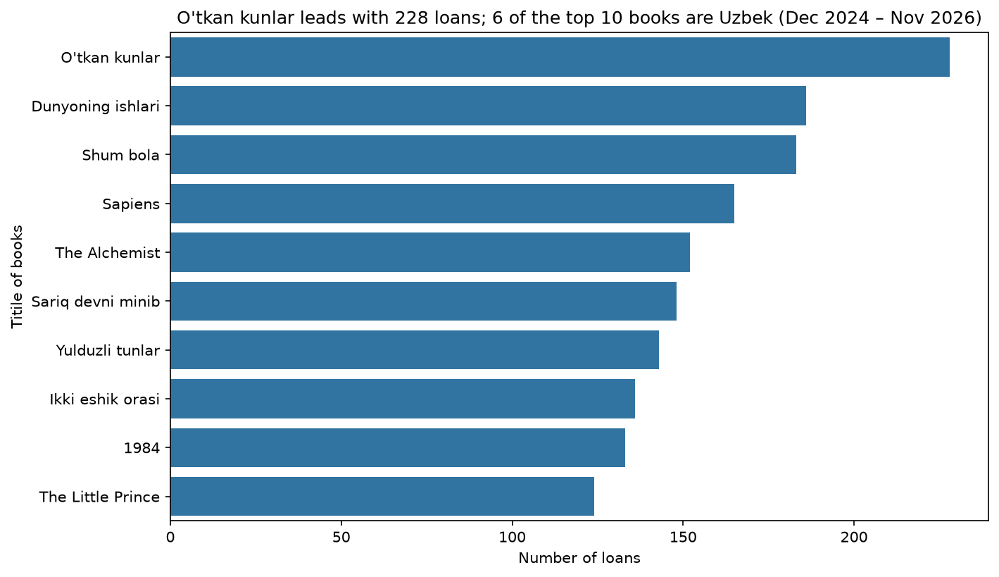

# Kutubxona Library Analytics

End-to-end analysis of a library management database: SQL, data cleaning,
product metrics and Python visualisation.

**Business question:** how is the library used, where does it lose members and
reservations, and what should it improve?

**Data:** the database comes from my own Django app "Kutubxona" (library system).
For Sections 2–5 I use a larger synthetic version (400 members, 36 books, 3,479 loans
over ~2 years) generated with a script (see `data/`), plus a "messy" copy with planted
errors for cleaning practice. The synthetic data has built-in patterns (growth,
a summer dip, students returning late more often, an online reservation feature
launched in January 2026), so the numbers are realistic but not real.

## Sections
| # | Folder | Skills | Status |
|---|---|---|---|
| 1 | `01_business_questions/` | JOINs, CASE, dates, conditional aggregation | ✅ done |
| 2 | `02_window_functions/` | ROW_NUMBER, RANK, LAG/LEAD, running totals | ✅ done |
| 3 | `03_data_cleaning/` | finding and fixing data quality issues, clean views | ✅ done |
| 4 | `04_product_metrics/` | active users, cohort retention, funnel | ✅ done |
| 5 | `05_python_analysis/` | pandas, seaborn, final insights | ✅ done |

Each `.sql` file starts with a comment block: the business question, why it matters,
the result, and notes on how I checked it.

## 1. Business questions
Written and first checked on my own Django database (47 loans, small enough to check by eye), then re-run on Kutubxona v2. Several "patterns" in the small data disappeared or reversed with 3,479 loans, e.g. the late rate by membership type.
1. How many books are in each category?
2. How many loans are returned, active and overdue?
3. Overdue call list: who to phone, and how many days late?
4. Which 5 books are borrowed most?
5. How many loans per month? (trend)
6. Which members have never borrowed a book?
7. How many books and loans per author?
8. Late rate by membership type
9. Fines: paid vs unpaid, and which members owe the most
10. Average days a book is kept, per category

## 2. Window functions
All 10 queries are in `02_window_functions/window_functions.sql`.
1. Number each member's loans in time order
2. Each member's first loan (name, date, book)
3. Top 3 most borrowed books in each category
4. Days since the same member's previous loan
5. Loans per month and % change vs the previous month
6. Running total of loans by month
7. 3-month moving average of monthly loans
8. Each book's share of its category's loans
9. Members in quartiles by activity: how much does the most active 25% borrow?
10. % of members who borrow again within 30 days of their first loan, by membership type

## 3. Data cleaning
Checks in `03_data_cleaning/cleaning.sql`, every issue in `03_data_cleaning/data_issues_log.md`.
1. Ran 6 checks on every table: size, categories, missing values, format, duplicates, logic
2. Found and logged 14 data quality issues with row counts (e.g. 12 duplicate members, 40 duplicate loans, 25 dates in the wrong format, 6 orphan loans)
3. Built `member_clean` view: trimmed and standardised names, emails, membership types, dates and phones; one row per person (412 -> 400 rows)
4. Built `loan_clean` view: fixed dates, removed duplicates, impossible returns and orphan loans (3,519 -> 3,461 rows)
5. Checked every view after cleaning (row counts reconciled, all checks return 0)

## 4. Product metrics
1. Monthly active borrowers, split into new and returning (`active_borrowers.sql`)
2. Monthly cohort retention: % of each join-month cohort borrowing 0–12 months later (`cohort_retention.sql`)
3. Reservation funnel: placed -> fulfilled -> borrowed within 30 days (`funnel.sql`)

## 5. Python analysis
Notebook: `05_python_analysis/kutubxona_analysis.ipynb`.
1. Loaded the tables into pandas and reproduced 3 SQL results (members per type, loans per month, top books); all match the SQL numbers
2. Chart: monthly loans (the incomplete current month is left out)
3. Chart: top 10 most borrowed books (pandas merge to get the titles)
4. Chart: cohort retention heatmap (SQL calculates, Python draws; incomplete months removed)

## Key findings

1. **Many reservations are cancelled.** 22% of online reservations (47 of 213) are cancelled before the book is ready. That's the biggest drop in the reservation funnel, bigger than members not picking up their books (18%). The library should find out why reservations are cancelled (e.g. waiting time) and buy extra copies of the books with the longest queues.

2. **Strong growth, but a summer dip.** Monthly loans grew 8× (33 in Jan 2025 -> 267 in Oct 2026), but fell 28% in summer 2026 (241 in May -> 173 in June), likely because students are on holiday. The library should run a summer reading challenge for students to keep them borrowing.

3. **A small group drives most loans.** The top 25% of members make 69.3% of all loans, so the library depends on a few heavy readers: if some of them leave, loans drop a lot. The library should keep them (e.g. premium benefits) and remind the less active 75% about their membership by email.

4. **New members start borrowing later.** 35 of 400 members (9%) never borrowed, and the share of new members who borrow in their first month fell from 69% to 56% for the 2026 cohorts. The library should send a welcome message in the first 14 days, and could add a loyalty card with a small prize for the 10th loan.

5. **Popular books have too few copies.** Demand per copy matters more than total loans: *Sapiens* has 165 loans on 6 copies (27.5 per copy), more than *O'tkan kunlar* with 228 loans on 10 copies (22.8 per copy). The library should buy copies based on loans per copy, not total loans.

### Charts







## How to run
1. Create the databases (standard Python only, nothing to install):
   ```
   py data/make_kutubxona_v2.py data
   ```
   This writes `data/kutubxona_v2.sqlite` and `data/kutubxona_messy.sqlite` (both git-ignored).
   Dates are relative to the day you run it, so your numbers will differ slightly from mine.
2. SQL (Sections 1–4): open the database in any SQLite tool (I use HeidiSQL) and run the `.sql` files.
   Section 3 uses `kutubxona_messy.sqlite`; Sections 2 and 4 use `kutubxona_v2.sqlite`.
3. Python (Section 5): `py -m pip install pandas matplotlib seaborn ipykernel`, open the notebook,
   set `DB_PATH` in the first cell to your `kutubxona_v2.sqlite`, and run all cells.

## Tools
SQLite, HeidiSQL, Python (pandas, matplotlib, seaborn), Jupyter in VS Code, Git